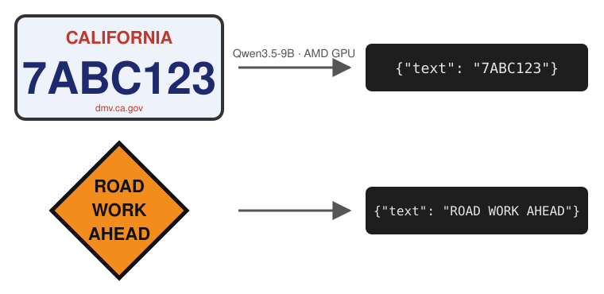

# OCR on AMD GPUs: license plates and road signs

<p align="center"></p>

Reads the text that counts from a photo of a US or Chinese license plate or a road sign, for the
AMD AI Challenge (OCR). One open vision-language model, **Qwen3.5-9B** in bf16 on **ROCm**, prompted
with the grading rules: plate number only (no state name or slogan), Chinese province character kept,
sign text top to bottom, no added units.

## How it works

- `app/server.py` loads and warms up the model once, when the container starts.
- `app/app.py` is the per-image entry point. It asks the server and writes `/app/output/<name>_output.json`,
  giving up with an empty answer after 27 s so the 30 s limit is never hit.
- `app/ocr.py` handles any image size, PNG, JPEG and 16-bit TIFF, the prompt, and output cleanup.

## Results

| Test set | Score | Slowest image |
|---|---|---|
| 10 challenge samples | 10/10 | 2.9 s |
| 150 synthetic plates and signs with blur, glare, noise, skew, low light (`tools/make_testset.py`) | 150/150 | 3.5 s |

About 0.5 s per image on a Radeon (RDNA3) GPU, 18 GiB VRAM. Image size 47 GiB.

## Run

In the ROCm PyTorch image (its torch is kept):

```bash
uv pip install --python "$(which python)" -r pyproject.toml
hf download Qwen/Qwen3.5-9B --local-dir models/Qwen3.5-9B
python tools/make_testset.py data/hard 150 && OCR_MODEL=models/Qwen3.5-9B python tools/eval.py data/hard
```

## Build the image

- With Docker: `docker build -t ocr .`
- Without Docker, which is how the submitted image was built: `tools/build_image.sh` builds and tests
  the layers, then `tools/assemble.sh` stacks them on the ROCm base inside the registry with
  [crane](https://github.com/google/go-containerregistry), so the base is never downloaded and stays
  byte-identical.
